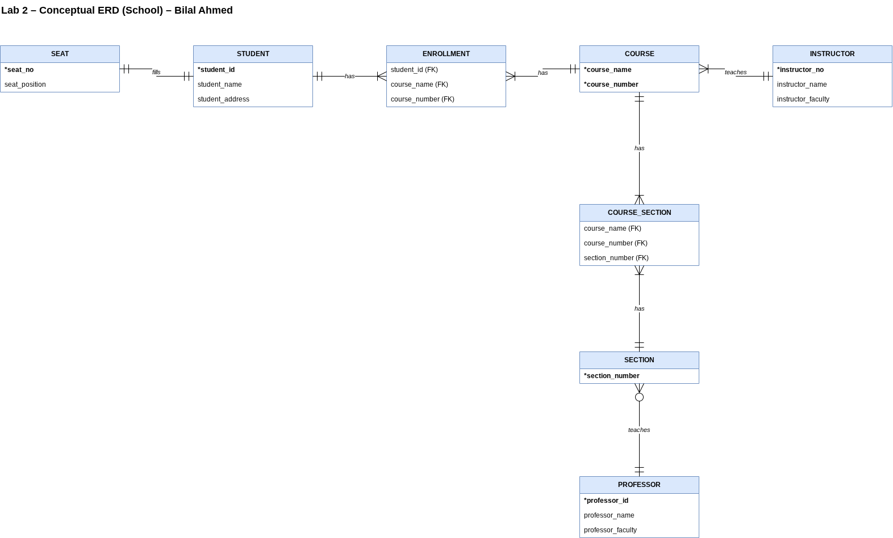

# Lab 2 - Conceptual Modeling using Draw.io
This lab will meet the following course objectives:
1. Determine appropriate entity structure for relational databases

2. Apply the correct terminology to an ER Model

3. Design an ER model

## Instructions
In this lab, you will practice writing business rules that describe the relationships between entities. Using the school ER diagram below, write and recreate a conceptual ER diagram that illustrates the relationships shown.

You will record your relationships within this README file.  When writing down the relationships, follow the bullet points below.
- Entity names are uppercase and bolded
- The connecting verb is underlined
- Bidirectionality of the relationship is represented

Once you complete the README.md file, create an ER Diagram based on the relationships you identified. Create the ER Diagram using a free web-based tool called draw.io.  The shapes you will use to create your ER diagram can be found under the "Entity Relation" tab.  Instructions on how to use draw.io are in the assignment resources section below.

## Requirements

### Deliverable 1 (5 Points)
All relationships are identified, including the relationships that are formed when identifying the new **associative entities**

### Deliverable 2 (5 Points)
Update the ReadMe.md file to reflect the relationships. The relationships adhere to the following bullet points below.
- Entity names are uppercase and bolded
- The connecting verb is <ins>underlined</ins>

- Bi-direction of the relationship is represented

### Deliverable 3 (5 Points)
A conceptual Entity Relationship Diagram(ERD) is created to reflect all entities and relationships identified in the write-up

## Submission Guidelines

For this lab, submit 2 items to the repository.  The two items that you will need to submit are listed below: 
1. The README.MD file that identifies the various Entities and briefly describes each entity, including possible attributes, relationships, and assumptions. 
   1. When identifying relationships, be sure to bold and uppercase the entity name, underline the verb, and make sure relationships are bidirectional. 
   2. When identifying assumptions, make sure to formulate assumptions based on what is represented in the school ERD with either a Yes or No. 
   3. You can override this README.md file that contains the instructions or extend this README.md file by listing your requirements below the lab Resources section.

2. The draw.io XML file that contains your ER Diagram.  You will also need to take a snippet of the ER Diagram and add it as an image in your README file.

Once you complete both items above, submit the link to your repository for lab 2 before the due date and time listed.  

## Lab Resources
- [Mark-down Syntax Cheat Sheet](https://enterprise.github.com/downloads/en/markdown-cheatsheet.pdf)
- [Make a ReadMe file Web-based Editor](https://www.makeareadme.com/)
- [Draw.io Web-based diagramming tool](https://app.diagrams.net/)
- [Creating Entity Relationship Diagrams using Draw.io](https://www.youtube.com/watch?v=lAtCySGDD48)

---

# Lab 2 Submission – Bilal Ahmed

## Entities

| Entity | Description | Possible Attributes |
|---|---|---|
| **STUDENT** | A person enrolled at the school. | student_id (identifier), student_name, student_address |
| **SEAT** | A seat that is occupied by a student. | seat_no (identifier), seat_position |
| **INSTRUCTOR** | The person assigned to teach each course. | instructor_no (identifier), instructor_name, instructor_faculty |
| **COURSE** | A course that students enroll in. | course_name and course_number (composite identifier) |
| **SECTION** | A section designated for a course. | section_number (identifier) |
| **PROFESSOR** | The person assigned to teach each section. | professor_id (identifier), professor_name, professor_faculty |
| **ENROLLMENT** | *Associative entity.* A record created when one student signs up for one course. | student_id, course_name, course_number |
| **COURSE_SECTION** | *Associative entity.* Links each course to its sections. | course_name, course_number, section_number |

## Relationships

### Original relationships
1. A **STUDENT** <u>fills</u> exactly one **SEAT**.
   A **SEAT** <u>is filled by</u> exactly one **STUDENT**. *(one-to-one)*
2. A **STUDENT** <u>takes</u> one or many **COURSES**.
   A **COURSE** <u>is taken by</u> one or many **STUDENTS**. *(many-to-many → resolved by ENROLLMENT)*
3. An **INSTRUCTOR** <u>teaches</u> one or many **COURSES**.
   A **COURSE** <u>is taught by</u> exactly one **INSTRUCTOR**. *(one-to-many)*
4. A **COURSE** <u>has</u> one or many **SECTIONS**.
   A **SECTION** <u>belongs to</u> one or many **COURSES**. *(many-to-many → resolved by COURSE_SECTION)*
5. A **PROFESSOR** <u>teaches</u> zero or many **SECTIONS**.
   A **SECTION** <u>is taught by</u> exactly one **PROFESSOR**. *(one-to-many)*

### Relationships formed by associative entities
6. A **STUDENT** <u>has</u> one or many **ENROLLMENTS**.
   An **ENROLLMENT** <u>belongs to</u> exactly one **STUDENT**.
7. A **COURSE** <u>has</u> one or many **ENROLLMENTS**.
   An **ENROLLMENT** <u>is for</u> exactly one **COURSE**.
8. A **COURSE** <u>has</u> one or many **COURSE_SECTIONS**.
   A **COURSE_SECTION** <u>belongs to</u> exactly one **COURSE**.
9. A **SECTION** <u>has</u> one or many **COURSE_SECTIONS**.
   A **COURSE_SECTION** <u>belongs to</u> exactly one **SECTION**.

## Assumptions (based on the school ERD)

| # | According to the ERD... | Answer |
|---|---|---|
| 1 | Can a student exist without a seat? | **No** |
| 2 | Can a course have more than one instructor? | **No** |
| 3 | Can a student take zero courses? | **No** |
| 4 | Can a section exist without a professor? | **No** |
| 5 | Can a professor teach zero sections? | **Yes** |
| 6 | Can a seat be filled by more than one student? | **No** |

## Conceptual ER Diagram

  
